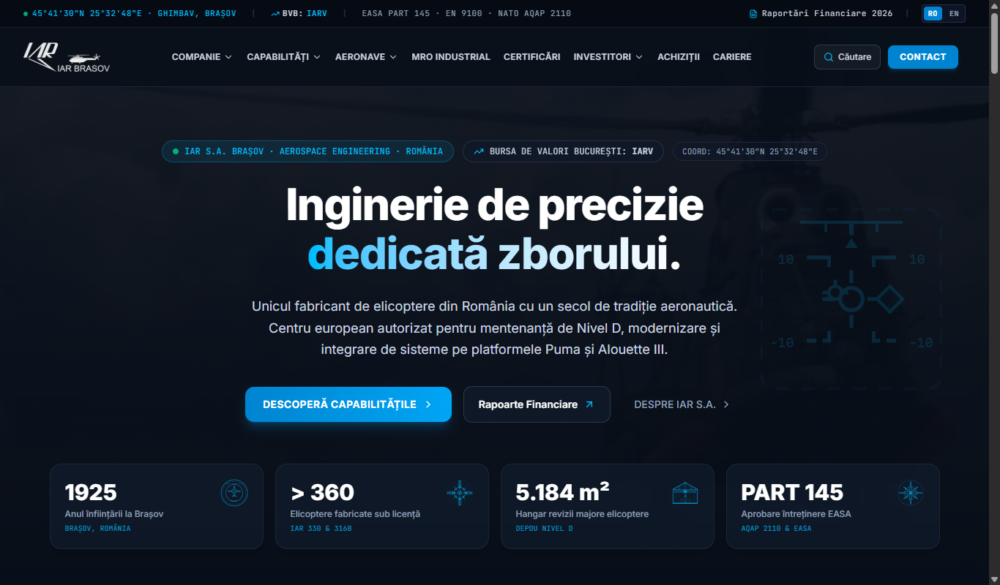
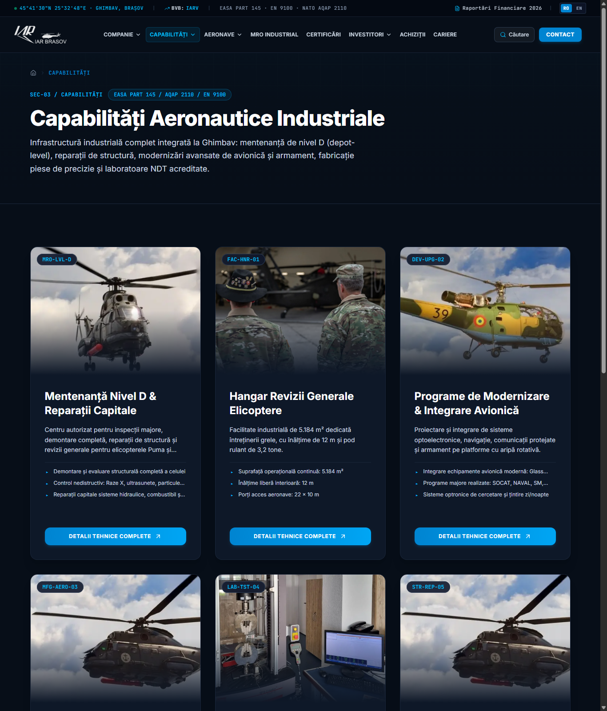
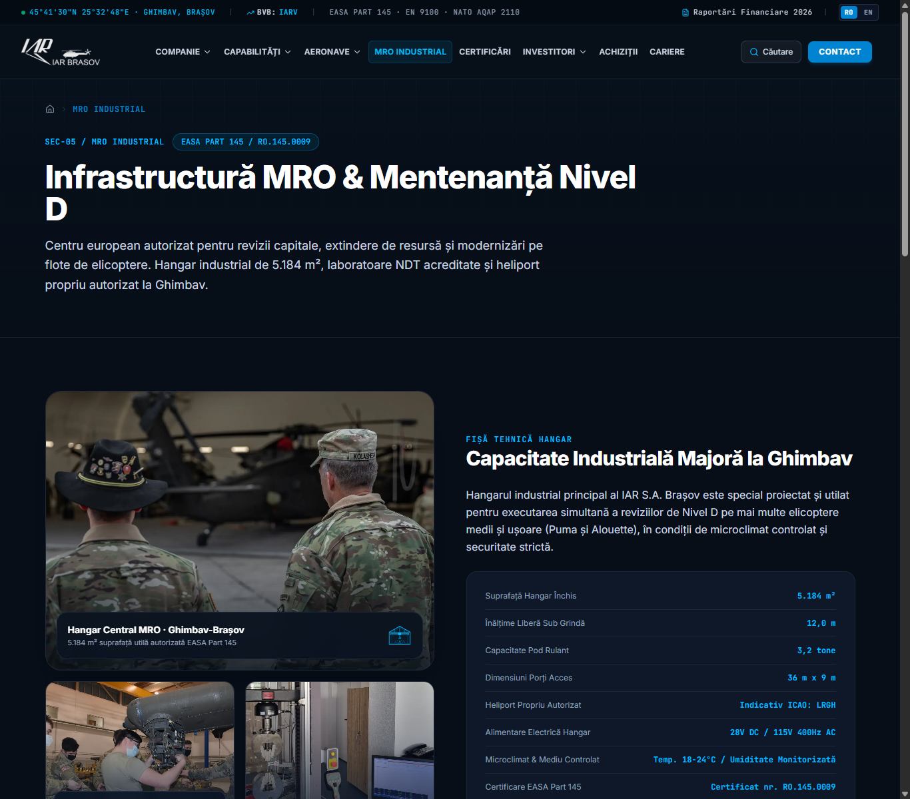

# IAR S.A. Brașov

Website bilingv de prezentare pentru IAR S.A. Brașov, construit cu Next.js. Interfața include pagini despre companie și istoria sa, capabilități industriale, aeronave, mentenanță MRO, relații cu investitorii și contact.

## Capturi de ecran

### Pagina principală



### Capabilități și modernizare



### Mentenanță MRO



## Tehnologii

- Next.js 15 cu App Router
- React 19 și TypeScript
- Tailwind CSS 4
- Radix UI, Framer Motion și Zod

## Rulare locală

Ai nevoie de Node.js 20 sau mai nou.

```bash
npm ci
npm run dev
```

Deschide [http://localhost:3000](http://localhost:3000). Ruta rădăcină redirecționează la `/ro`; versiunea în engleză este disponibilă la `/en`.

Pentru o versiune de producție:

```bash
npm run build
npm start
```

## Observație despre formularul de contact

Ruta API validează datele formularului și le scrie în logurile serverului. Trimiterea efectivă a mesajelor prin e-mail nu este configurată în acest repository.
